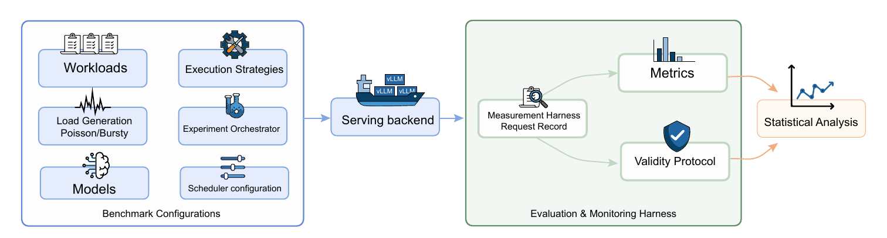
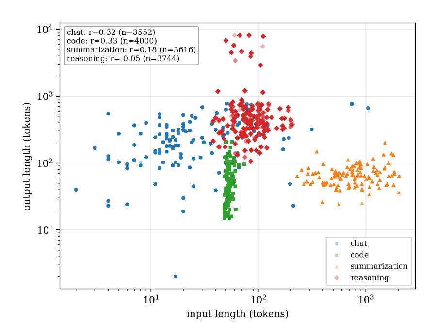
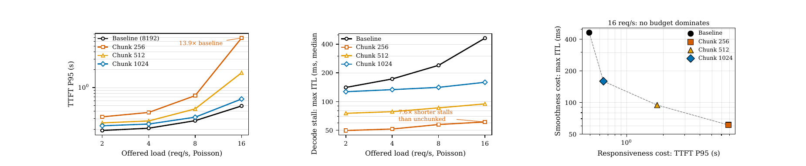
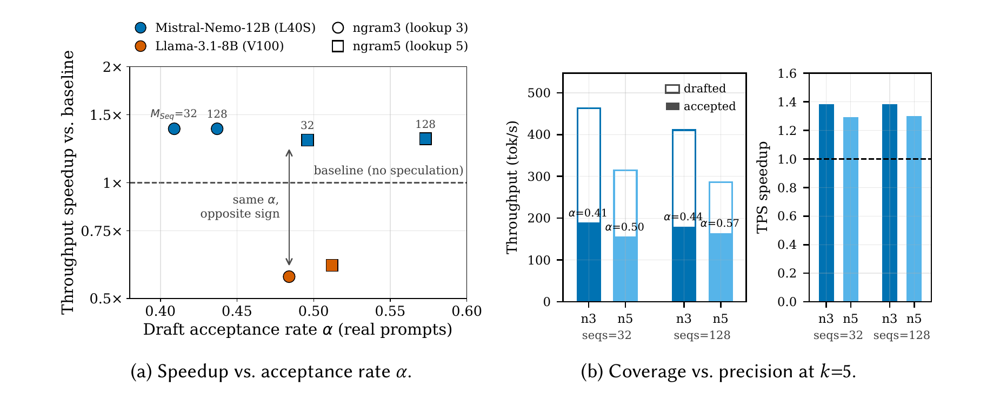
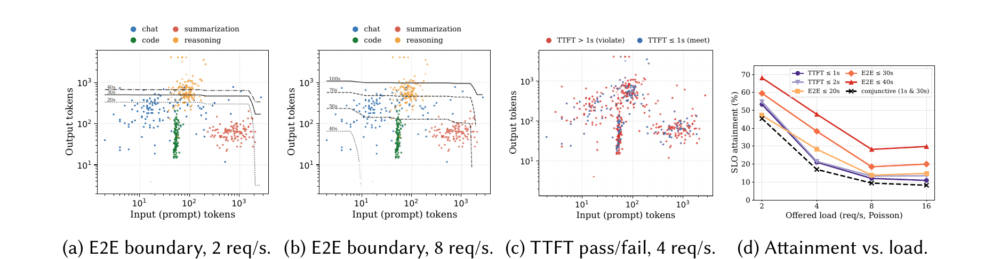

# STRATA-Bench

**A Regime-Aware Benchmark of Execution Strategy Efficiency in LLM Serving**

[](https://doi.org/10.1145/3857383)
[](https://doi.org/10.1145/3857383)
[](https://zenodo.org/records/21302857)
[](#license)

Farhoud Jafari Kaleibar, Honggeun Ji, Amr M. Zaki, Marin Litoiu — York University, Toronto, Canada

> Official benchmark harness for the paper *"STRATA-Bench: A Regime-Aware Benchmark of Execution Strategy Efficiency in LLM Serving"*, Proc. ACM Meas. Anal. Comput. Syst. (POMACS) **10**(3), Article 080, December 2026 — presented at **ACM SIGMETRICS 2027**.

---

## Overview

LLM serving systems deploy execution strategies — chunked prefill, speculative decoding, concurrency admission control — as **static, deployment-time configurations** applied uniformly to every request. STRATA-Bench measures how the efficiency of those strategies actually depends on **workload, offered load, arrival pattern, and model architecture**.

The harness instruments vLLM (V1 engine) and records full per-request latency distributions — TTFT, inter-token latency (ITL), end-to-end latency (E2E), speculative acceptance rate, preemptions and SLO attainment — across a grid of execution strategies, four real-world workload types plus a mixed composition, Poisson and bursty arrivals at four offered rates (2–16 req/s), and four model architectures (7B–13B) spanning grouped-query and multi-head attention on NVIDIA V100 and L40S GPUs.

**Central finding:** no single static configuration is efficient across the operating envelope a production serving system encounters. Each mechanism has *regimes* in which it flips from beneficial to harmful, and those regime boundaries are a property of the deployment, not of the mechanism.

---

## Methodology

<p align="center">
  
</p>
<p align="center"><em>Figure 1. Benchmark methodology overview (paper Fig. 1).</em></p>

The pipeline has three stages:

**1. Benchmark configurations.** Each experiment is a point in a configuration space:

| Component | What it defines | Code |
|---|---|---|
| **Workloads** | A request trace $\mathcal{W} = \{(x_i, y_i, t_i)\}_{i=1}^{N}$ of input length, output length and task type. Each task type exists in a *synthetic* form (precise length control) and a *real* form (natural heavy-tailed distributions). | `config/workloads.py` |
| **Load generation** | Offered rate $\lambda \in \{2, 4, 8, 16\}$ req/s; Poisson ($\Delta t \sim \mathrm{Exp}(\lambda)$) or bursty (bursts of $b = 8$) arrivals with matched long-run rate. | `config/workloads.py` |
| **Models** | Any vLLM-servable Hugging Face checkpoint (preset library or custom ID). | `tui.py`, `--model` |
| **Execution strategies** | Configuration tuple $\mathbf{c} = (\tau, \chi, \ell, \pi, p)$: strategy type, chunk size, speculative lookup length, tensor-parallel degree, precision. | `config/strategies.py` |
| **Experiment orchestrator** | Sequences the grid, manages server lifecycle (launch, warm-up, teardown), enforces per-request TTFT/E2E timeout budgets, pins target GPUs. | `main.py`, `benchmark/launcher.py` |
| **Scheduler configuration** | Admission/concurrency cap $M_{Seq}$ (`--max-num-seqs`) and chunked-prefill token budget (`--max-num-batched-tokens`). | `config/strategies.py` |

**2. Serving backend.** vLLM as an OpenAI-compatible HTTP server, models served at their published fp16/bf16 checkpoints.

**3. Evaluation & monitoring harness.**

- **Measurement harness / request record.** An async replayer streams every request over SSE and retains the complete record for *every* request, including failures:
  $\mathcal{R}_i = \big(t_i^{\text{req}}, \{t_i^{(k)}\}_{k=1}^{L_i}, L_i, s_i, e_i\big)$, with outcome $s_i \in$ {success, timeout, error}. KV-cache occupancy, running/waiting sequences and preemptions are polled from vLLM `/metrics`; GPU utilization, memory and power are sampled at 1 Hz via NVML.
- **Metrics.** Derived directly from $\mathcal{R}_i$:

  $$\mathrm{TTFT}_i = t_i^{(1)} - t_i^{\text{req}}, \qquad \mathrm{ITL}_i = \frac{1}{L_i - 1}\sum_{k=2}^{L_i}\big(t_i^{(k)} - t_i^{(k-1)}\big), \qquad \mathrm{E2E}_i = t_i^{(L_i)} - t_i^{\text{req}}$$

  plus run-level decode throughput, energy efficiency, KV-cache occupancy, preemption count, speculative acceptance rate and SLO attainment.
- **Validity protocol.** Three checks applied uniformly to every reported cell:
  1. **KV-cache exhaustion** — configurations with failure rate $\rho_{\text{fail}} = N_{\text{failed}}/N_{\text{total}} > 0.30$ are excluded from quantitative fitting (but still reported).
  2. **Timeout truncation** — requests that receive a first token but exceed the wall-clock budget are classified as truncated, not KV-exhausted.
  3. **Cold-start transient** — each trace is replayed over multiple replicates after a fresh server launch; the first two replicates are a mandatory burn-in and are discarded.
- **Statistical analysis.** Request-level (not per-workload-averaged) power-law fits $y = a x^{\gamma}$ via OLS on log-transformed data, reporting $\gamma$ with a 95% CI, $R^2$ and sample count, used descriptively to detect queueing-vs-length regime transitions.

---

## Workloads

<p align="center">
  
</p>
<p align="center"><em>Figure 2. Joint distribution of input and output token counts across the four real-world workloads.</em></p>

| Task | Shape | Real-data loader (Hugging Face) | Workload names |
|---|---|---|---|
| Chat | short–medium prompts, moderate outputs, widest dispersion | `anon8231489123/ShareGPT_Vicuna_unfiltered` | `chat`, `chat_real`, `chat_real_long` |
| Code generation | tight cluster of short prompts, brief completions | `google-research-datasets/mbpp` | `code`, `code_real` |
| Summarization | prefill-heavy: long prompts, short outputs | `abisee/cnn_dailymail` | `summarization`, `summarization_real`, `summarization_real_long` |
| Multi-step reasoning | moderate prompts, heavy-tailed CoT outputs up to $10^4$ tokens | `nvidia/OpenMathReasoning` | `reasoning`, `reasoning_real` |
| Mixed | all four interleaved; cross-task KV-cache interference | all of the above | `mixed`, `mixed_real` |

Synthetic workloads give precise control over input lengths but inflate speculative acceptance rates through textual repetition; the paper reports both forms to separate artifacts of prompt construction from findings that hold under natural traffic.

## Models and Hardware (paper setup)

| Model | Params | Precision | GPU |
|---|---|---|---|
| Llama-3.1-8B-Instruct | 8B | FP16 | NVIDIA V100-SXM2 32 GB |
| Llama-2-13B-Chat | 13B | FP16 | NVIDIA L40S 48 GB |
| Mistral-Nemo-12B-Instruct | 12B | BF16 | NVIDIA L40S 48 GB |
| DeepSeek-R1-Distill-Qwen-7B | 7B | BF16 | NVIDIA V100-SXM2 32 GB |

The paper holds tensor parallelism and precision fixed ($\pi = 1$, fp16/bf16) to isolate each mechanism's regime dependence; the harness additionally supports TP-2/TP-4, FP8/AWQ quantization and compound chunked + speculative configurations.

---

## Research Questions and Key Findings

All results characterize a **colocated, single-engine vLLM deployment**, where prefill and decode share one scheduler, admission pool and GPU.

### RQ1 — Cost separability: admission control relocates cost, it does not remove it

TTFT is predictable from prompt length only when the concurrency cap leaves headroom ($M_{Seq} \ge 64$); below that, TTFT is governed by queueing delay ($\gamma \to 0$, $R^2 \approx 0$). With $M_{Seq} = 128$, E2E is cleanly driven by output length (decode fraction > 0.98, $\gamma \approx 1$). But the cap that keeps TTFT sub-150 ms produces the largest ITL degradation under load (mean ITL +65.8%, P95/mean jitter 1.12 → 2.42): a restrictive cap shifts the cost of high load from TTFT onto inter-token latency rather than eliminating it.

### RQ2 — Chunked-prefill token budget: a zero-sum dial

<p align="center">
  
</p>
<p align="center"><em>Figure 6. Responsiveness (TTFT P95), smoothness (decode stall), and the trade-off frontier at 16 req/s.</em></p>

At 16 req/s a 256-token budget trades **13.9× higher TTFT P95** for **7.6× shorter decode stalls**, while E2E moves by less than 12%; no static budget dominates. The *beneficial direction* is set by the KV-cache pressure of the model's attention architecture, not by the workload: the same small budget weakly dominates the unchunked baseline on a high-KV-pressure (MHA) model.

### RQ3 — n-gram speculative decoding: the acceptance-rate crossover is not universal

<p align="center">
  
</p>
<p align="center"><em>Figure 8. (a) Throughput speedup vs. draft acceptance rate α on real prompts. (b) Drafted vs. accepted token throughput, ngram3 vs. ngram5.</em></p>

At essentially the same acceptance rate ($\alpha \approx 0.5$), speculation gives **1.28–1.46×** throughput on Mistral-Nemo-12B and is **harmful (0.57–0.61×)** on Llama-3.1-8B. The crossover is a property of the model–hardware pair. Acceptance rate alone does not rank variants either: ngram3 beats ngram5 despite lower $\alpha$ because it drafts more tokens per second (coverage over precision). The main benefit is tail compression (p99 cut 2.5–2.6×), and the TTFT benefit only appears when the admission cap is tight enough for a queue to form.

### RQ4 — Model architecture sensitivity: mechanisms transfer, operating points do not

| Model (GPU) | RQ1 decode_frac range | RQ2 chunked-prefill trade-off | RQ3 spec. decoding TPS vs. baseline |
|---|---|---|---|
| Mistral-Nemo-12B (L40S) | 0.11 → 0.98 | zero-sum, no winner | 1.28×–1.46× |
| Llama-2-13B (L40S) | 0.15 → 0.98, transfers | **C256 dominates B** | 1.25×–1.42×, same sign |
| DeepSeek-7B (V100) | 0.12 → 0.20, transfers | harmful, matches Nemo | 1.18× |
| Llama-3.1-8B (V100) | 0.11 → 0.25, transfers | harmful, matches Nemo | **0.57×–0.61×** |

The queue-to-decode phase transition, the chunk-budget stall cap and the existence of an acceptance-rate crossover all reproduce across models; the sign of the chunked-prefill trade-off and every effect magnitude do not. KV-cache *capacity* pressure, not preemption count, governs the chunked-prefill sign flip.

### RQ5 — SLO attainment and the trade-off frontier

<p align="center">
  
</p>
<p align="center"><em>Figure 10. SLO attainment for Llama-2-13B on <code>mixed_real</code>: E2E boundary in the token plane, TTFT pass/fail, and attainment vs. offered load.</em></p>

The E2E attainment boundary is governed by output length and recedes with load; TTFT attainment is not separable by prompt length at all ($R^2 = 0.002$). The two boundaries are near-orthogonal, so **conjunctive** TTFT ∧ E2E attainment is strictly lower than either marginal alone. Preemption inflates p95 decode stall up to 8.2× while remaining invisible to TTFT and E2E — latency-only reporting can score a preemption-thrashing configuration as healthy.

---

## Repository Structure

```
STRATA-BENCH/
├── main.py                       CLI entry point and experiment orchestrator
├── tui.py                        Interactive terminal UI (model / strategy / workload / rate picker)
├── requirements.txt
├── config/
│   ├── strategies.py             Execution-strategy tuples + vLLM CLI argument builder
│   └── workloads.py              Synthetic and real-data workloads, Poisson/bursty trace generator
├── benchmark/
│   ├── launcher.py               vLLM server lifecycle (launch, health-poll, teardown)
│   ├── runner.py                 Async SSE trace replayer: TTFT / ITL / E2E per request
│   ├── gpu_monitor.py            1 Hz NVML sampler (pynvml, nvidia-smi fallback)
│   ├── storage.py                Per-run CSV + JSON persistence
│   └── analysis/
│       ├── cost_model.py         Separability / dominance analysis, cost-model fitting
│       └── report.py             Figures (PDF) and LaTeX tables
├── docs/figures/                 Figures from the paper used in this README
└── RESEARCH_OVERVIEW.md          Early design notes that preceded the paper
```

The `__init__.py` files in `benchmark/`, `benchmark/analysis/` and `config/` are required for package imports; do not delete them.

---

## Installation

```bash
git clone https://github.com/farhoudjk/STRATA-BENCH.git
cd STRATA-BENCH

python -m venv .venv
source .venv/bin/activate

# Benchmark dependencies
pip install -r requirements.txt

# vLLM (V1 engine) — install after requirements so transformers stays pinned.
# vllm==0.11.0 pins torch==2.8.0 (CUDA 12.8 build); check `nvidia-smi` for your driver.
pip install vllm==0.11.0

# Required for gated models (e.g. Llama)
huggingface-cli login

# Sanity check
python -c "import torch, vllm; print(torch.cuda.is_available(), vllm.__version__)"
python -c "from benchmark.runner import run_benchmark; print('imports OK')"
```

---

## Running the Benchmark

Run all commands from the repository root.

### Interactive TUI (recommended)

```bash
python tui.py
```

Arrow-key menus for model, strategies, workloads, arrival rates/patterns and `max_num_seqs` sweeps.

### Single strategy × workload (smoke test)

```bash
python main.py \
  --model mistralai/Mistral-Nemo-Instruct-2407 \
  --strategy baseline_full_fp16_tp1 \
  --workload mixed_real \
  --rates low
```

### RQ1 — admission cap × rate × arrival pattern

```bash
for seqs in 16 32 64 128; do
  python main.py \
    --model mistralai/Mistral-Nemo-Instruct-2407 \
    --strategy baseline_full_fp16_tp1 \
    --workload mixed_real \
    --rates low med high vhigh \
    --arrival-patterns poisson bursty \
    --max-num-seqs-override $seqs
done
```

### RQ2 / RQ3 — ablation over one dimension

```bash
# Chunked-prefill token budget (baseline vs. 256 / 512 / 1024)
python main.py --model <model> --dimension chunked_prefill \
  --workload mixed_real --rates low med high vhigh

# n-gram speculative decoding (baseline vs. ngram3 / ngram5)
python main.py --model <model> --dimension speculation \
  --workload mixed_real --rates low med high vhigh --arrival-patterns poisson bursty
```

Available dimensions: `chunked_prefill | tensor_parallel | speculation | quantization | interaction`.

### Full grid and report regeneration

```bash
python main.py --model <model> --run-all --gpu-indices 0
python main.py --model placeholder --report-only --run-id <run_id>
```

For models with a native context shorter than 8192 tokens (e.g. Llama-2: 4096), add `--max-model-len-override 4096`.

### CLI Reference

| Argument | Default | Description |
|---|---|---|
| `--model` | required | Hugging Face model ID or local path |
| `--run-all` / `--strategy` / `--dimension` / `--report-only` | — | Execution mode (mutually exclusive, one required) |
| `--workload`, `--workloads` | `chat` | One or more workload names |
| `--rates` | `low` | `low` (2) · `med` (4) · `high` (8) · `vhigh` (16) req/s |
| `--arrival-patterns` | `poisson` | `poisson`, `bursty` |
| `--max-num-seqs-override` | — | Admission cap $M_{Seq}$ |
| `--max-model-len-override` | — | Override context length (default 8192) |
| `--num-requests` | per workload | Override requests per trace |
| `--max-concurrent` | `16` | Client-side in-flight request limit |
| `--request-timeout` | `300` | Per-request E2E budget (s) |
| `--ttft-timeout` | `120` | Abort if no first token within this many seconds |
| `--gpu-indices` | `0` | Comma-separated GPU indices |
| `--port` | `8100` | vLLM server port |
| `--seed` | `42` | Trace seed |
| `--results-dir` / `--run-id` | `results/` / timestamp | Output location |
| `--no-gpu-monitor`, `--debug`, `--extra-vllm-args` | — | Monitoring, logging, passthrough vLLM args |

---

## Output

```
results/{run_id}/
├── requests.csv        One row per request: TTFT, E2E, ITL mean/p50/p95/max, TPS, status/error,
│                       completion ratio, KV-cache %, running/waiting seqs, preemptions,
│                       speculative acceptance rate, rate/pattern/max_num_seqs metadata
├── gpu_samples.csv     1 Hz GPU utilization, memory, power, temperature
├── summary.json        P50/P95/P99 aggregates per strategy × workload × rate
├── vllm_{strategy}.log Server logs
├── figures/            TTFT CDF, dominance heatmap, latency boxplots, KV-pressure scatter, ...
├── tables/             LaTeX summary / efficiency / interaction tables
└── analysis/           Dominance pivot, interactions, separability (R²) results
```

The complete per-request measurement corpus and analysis scripts used for every figure and table in the paper are archived at **[Zenodo 21302857](https://zenodo.org/records/21302857)**.

---

## Scope and Limitations

- Results characterize **colocated, single-engine** serving; prefill/decode disaggregation or multi-GPU serving changes the contention structure and requires re-measurement.
- Speculative-decoding findings cover the **n-gram lookup** variant only, not drafter/verifier methods.
- Effects found to be model–hardware properties should be re-measured on a new deployment — that is the intended use of this harness.

---

## Citation

```bibtex
@article{jafarikaleibar2026stratabench,
  author    = {Jafari Kaleibar, Farhoud and Ji, Honggeun and Zaki, Amr M. and Litoiu, Marin},
  title     = {{STRATA-Bench}: A Regime-Aware Benchmark of Execution Strategy Efficiency in {LLM} Serving},
  journal   = {Proceedings of the ACM on Measurement and Analysis of Computing Systems},
  volume    = {10},
  number    = {3},
  articleno = {080},
  numpages  = {30},
  year      = {2026},
  month     = dec,
  publisher = {Association for Computing Machinery},
  doi       = {10.1145/3857383},
  url       = {https://doi.org/10.1145/3857383}
}
```

---

## License

Code: MIT. The paper is published under a Creative Commons Attribution 4.0 International License; figures in `docs/figures/` are reproduced from it.
